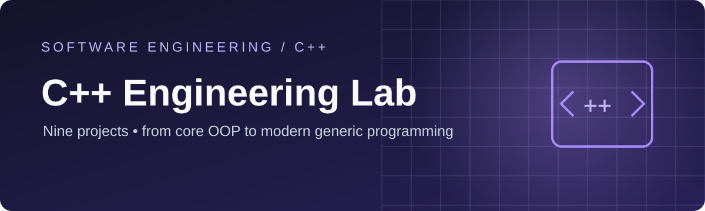
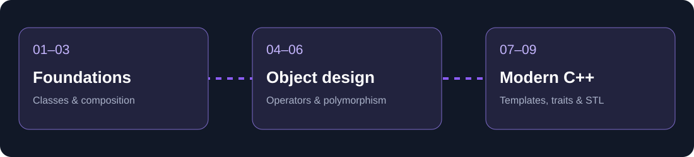

<div align="center">



# C++ Engineering Lab

**9 focused projects · OOP → generic programming → STL**

A curated collection of C++ coursework implementations, organized to make the engineering concepts and code easy to explore.

  

</div>

## At a glance



This collection progresses from class design and resource management to inheritance, reusable generic containers, compile-time programming, and STL-based applications.

## Project explorer

| # | Project | What it demonstrates | Focus |
|---|---|---|---|
| **01** | [Geometry & Fundamentals](projects/01-geometry-fundamentals) | Point, Circle and utility functions | `C++ basics · Classes` |
| **02** | [Music Library](projects/02-music-library) | Songs, playlists and library management | `Constructors · Destructors` |
| **03** | [Book Lending System](projects/03-book-lending-system) | Books and library cards with object composition | `Composition · Dynamic arrays` |
| **04** | [Student Gradebook](projects/04-student-gradebook) | Student records and grade operations | `Operator overloading` |
| **05** | [Complex Number Toolkit](projects/05-complex-number-toolkit) | Complex arithmetic and dynamic arrays | `Deep copy · Conversions` |
| **06** | [Polymorphic Zoo](projects/06-polymorphic-zoo) | Animal hierarchy and zoo management | `Inheritance · Polymorphism` |
| **07** | [Generic Containers](projects/07-generic-containers) | Reusable stack, queue and algorithms | `Templates · Iterators` |
| **08** | [Compile-Time Utilities](projects/08-compile-time-utilities) | Type traits, formatting and physics utilities | `Metaprogramming · decltype` |
| **09** | [Course Records & STL](projects/09-course-records-stl) | Student records, course management and string utilities | `STL · Type traits` |

## Featured implementations

<table><tr><td width="33%"><strong>06 · Polymorphic Zoo</strong><br/>Inheritance, abstract classes and polymorphic animal types.<br/><a href="projects/06-polymorphic-zoo">Explore →</a></td><td width="33%"><strong>07 · Generic Containers</strong><br/>Stack, queue, iterators and template-based algorithms.<br/><a href="projects/07-generic-containers">Explore →</a></td><td width="33%"><strong>08 · Compile-Time Utilities</strong><br/>Templates, type traits and decltype-based utilities.<br/><a href="projects/08-compile-time-utilities">Explore →</a></td></tr></table>

## Repository layout

```text
cpp-programming-projects/
├── assets/               # Portfolio visuals
├── projects/             # Nine self-contained C++ assignments
│   ├── 01-geometry-fundamentals/
│   ├── ...
│   └── 09-course-records-stl/
└── README.md
```

## Running the code

Each project includes its C++ source files and a `Makefile` for building where provided. From an individual project directory:

```bash
make
```

A C++ compiler and Make are required. The projects have not been re-tested as part of this presentation cleanup, so the commands and toolchain requirements may vary.

## About this collection

The original work was completed as part of a university C++ programming course. This repository is a **portfolio presentation of course assignments**, not a claim that the exercises were independently conceived. The repository presents the implementations and original build files while omitting course handouts and supplied assessment files.
